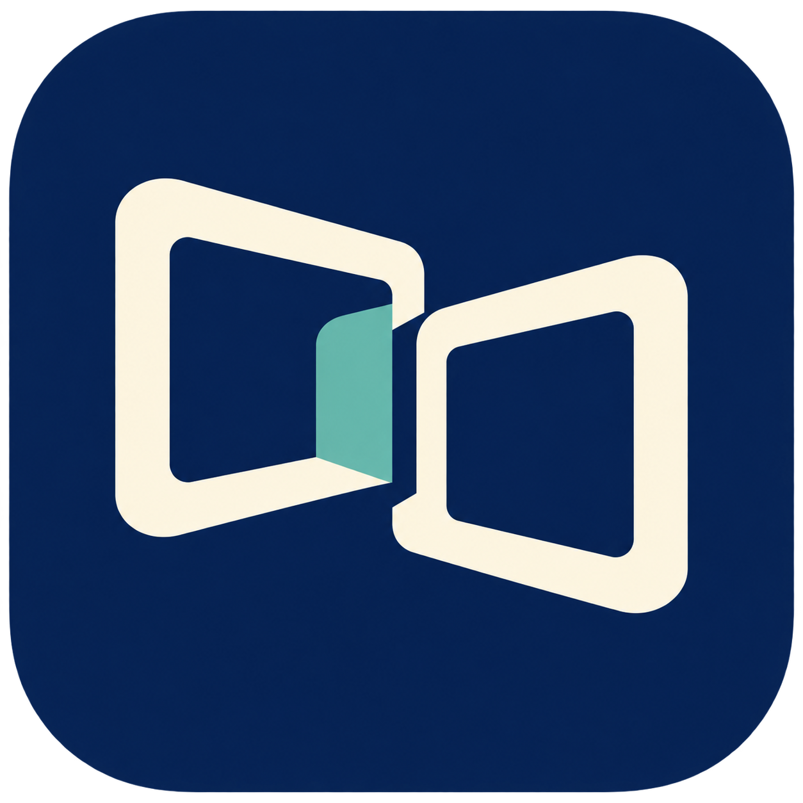

<p align="center">
  
</p>

# DeskBridge

**Bring your computers into one workspace.**

A free, open-source remote desktop app for work: open Windows in a full-screen Space on your Mac, control a Mac from Windows, or connect to a Linux desktop from Mac or Windows. Use your LAN/Wi-Fi or an existing Tailscale connection.

English · [한국어](README.ko.md)

> **Development preview · 0.2.0-preview.13**
>
> Real-device installation, video, input, audio and connection performance still need validation. Mac packages are ad-hoc signed and not notarized; Windows executables are unsigned previews. No performance or security advantage over other remote desktop products has been established.

[Installation](INSTALLATION.md) · [Security scope](SECURITY.md) · [Build and packaging](docs/RELEASING.md) · [Validation checklist](docs/VALIDATION.md)

The app UI and most setup guides are currently in Korean.

## Supported connections

In each row, the computer on the left controls the computer on the right.

| Connection | Video, keyboard, mouse and audio | File upload and download |
| --- | --- | --- |
| Mac → Windows 11 x64, including Home edition | Preview | Preview; separate SFTP setup |
| Windows 11 x64 → Mac | Preview; experimental Mac host support | Not supported |
| Mac or Windows 11 x64 → Ubuntu 24.04 LTS amd64 | Preview; logged-in X11 session | Not supported |

- **Mac app:** Apple Silicon, macOS 26 or later.
- **Linux:** host only. No Linux client, Wayland, headless or pre-login desktop support.
- Signing in, unlocking, waking from sleep and using virtual monitors are not guaranteed. The user must be logged in on the shared computer.

## Features

- **Full-screen Mac Spaces:** open a remote desktop and switch between macOS workspaces. Control+↑/←/→ stays local by default.
- **Discovery, QR and links:** choose a PC through Bonjour on your LAN or import an address QR/link. The Mac app supports QR images, camera scanning and links; the Windows client supports QR images and links.
- **Explicit pairing:** discovery results and QR codes are only address hints. PIN approval and saved certificate checks establish the connection.
- **Optional file transfer:** from the Mac client, browse the Windows share and upload or download individual files with progress and cancellation. Existing files are never overwritten.
- **Native apps:** SwiftUI/AppKit on Mac, WinForms on Windows and GTK for the Linux host. The Windows screen engine runs in a separate Moonlight window.

DeskBridge operates no cloud account or relay service. Set up Tailscale separately on both devices; traffic may pass through [Tailscale DERP relays](https://tailscale.com/docs/reference/connection-types), depending on the connection path. Bonjour does not enumerate peers across Tailscale, so use a QR code, link or address there.

## Packages and getting started

This development preview is currently published as source only; installers have not been published to GitHub Releases. Build from source, or fork the repository, enable Actions in your fork and use **Actions → Build install packages → Run workflow** to request a preview build. Manual workflow runs require [write access to that repository](https://docs.github.com/en/actions/how-tos/manage-workflow-runs/manually-run-a-workflow).

See the [workflow](.github/workflows/packages.yml) and [packaging guide](docs/RELEASING.md). Artifacts are created after a successful build, and [downloading them requires a GitHub login](https://docs.github.com/en/actions/how-tos/manage-workflow-runs/download-workflow-artifacts). GitHub-hosted builds in the new public repository have not yet been validated.

Once you have packages, follow the steps below. **Screen access does not require SSH setup.**

### Open Windows from Mac

1. Run the Windows quick-setup EXE as a regular user and choose **이 Windows 공유** (share this Windows PC). Follow the Sunshine installation steps.
2. Create the Sunshine administrator account. Set both LAN and WAN encryption to **Mandatory** under **Configuration → Network**, and check that a Desktop app is available.
3. Install DeskBridge on your Mac. Choose the PC under **Windows 화면** (Windows desktop), or import the Windows helper's QR/link if discovery finds nothing.
4. Approve the PIN shown on the Mac in Sunshine's PIN page on Windows, then choose **Windows 열기** (open Windows).

[Detailed installation](INSTALLATION.md#mac에서-windows-열기) · [Windows host and file setup](host/windows/README.md)

### Open Mac from Windows

Use **이 Mac 공유** (share this Mac) to prepare the official Sunshine app, enter the initial web administrator credentials, and start sharing. Grant Screen & System Audio Recording and Accessibility to the application named in the actual macOS permission request. On Windows, choose **Mac 열기** (open Mac) and select an address through QR/link/discovery. Approve the PIN shown in the Windows Moonlight window on the Mac Sunshine PIN page.

[Mac sharing guide](host/macos/README.md) · [Windows client guide](client/windows/README.ko.md)

### Open Linux from Mac or Windows

Install the Linux `.deb` on Ubuntu and open **DeskBridge Linux Host**. Install official Sunshine, enter the initial web administrator credentials and start sharing. Select an address and start PIN pairing through **Linux 화면** (Linux desktop) on Mac or **Linux 열기** (open Linux) on Windows. Approve the client's PIN on the Linux Sunshine PIN page.

[Ubuntu installation, permissions and firewall](host/linux/README.md)

## File transfer uses a separate connection

The file client is available only on Mac. It accesses the Windows share over OpenSSH/SFTP independently of Sunshine. Set up the dedicated standard Windows user and shared folder, select an SSH key on the Mac, and register the Windows SSH host key. Screen pairing grants no file-transfer access.

Recursive folders, resume, automatic synchronization and remote deletion are not supported. Newly generated dedicated Mac keys are unencrypted owner-only files; protect the Mac account and disk. Read the [file setup and limitations](host/windows/README.md) first.

## Security and networking

- Connections use selected private IPv4 addresses. Public IPs, DNS hostnames and IPv6 are not supported.
- Screen encryption is mandatory. The Mac client pins the host certificate; the Windows client manages pairing and certificates in a dedicated Moonlight profile. The two clients are hardened differently.
- Mac and Linux set up the Sunshine web administrator credentials you enter before opening the host service. Valid existing accounts and certificates are not automatically reset.
- Screen sharing grants remote control of the logged-in account. SFTP folder restrictions do not constrain desktop access.
- DeskBridge does not automatically configure your firewall or router. Use a trusted LAN/Tailscale network and do not forward these ports to the internet.

Official Sunshine and Windows Moonlight packages are downloaded separately on explicit user action, with pinned size/hash checks. The initial download requires internet access. Unmodified Moonlight may also request compatibility, controller and update information. DeskBridge adds no automatic clipboard synchronization. See [SECURITY.md](SECURITY.md) for protocol limits and validation scope.

## Build from source

### Mac

The validated toolchain is an Apple Silicon Mac with macOS 26 or later, Xcode 27 / Swift 6.4 and Python 3. Engine sources are vendored in this repository.

```sh
python3 scripts/build.py
```

This performs an optimized build and offline synthetic checks, producing `dist/DeskBridge.app`. It does not automatically open the app GUI or a real remote desktop.

### Linux host

```sh
python3 scripts/build_linux_host.py --output build/linux/DeskBridge-Linux.deb
```

The package targets Ubuntu 24.04 LTS amd64. See the [Linux guide](host/linux/README.md) and [workflow](.github/workflows/packages.yml) for dependencies and Linux-only checks.

Windows builds require a separate native compiler and .NET tools. The [packaging guide](docs/RELEASING.md) covers local builds, CI, signing and corresponding source.

## Contribute and license

For bugs, include your OS, app version, connection direction and reproduction steps. Do not post PINs, passwords, private keys, real files/desktops or raw service logs in public issues. Read the [security guidance](SECURITY.md) before reporting sensitive issues.

DeskBridge is **GPL-3.0-only**. Modifications and redistribution must preserve the applicable GPL terms and upstream notices and provide corresponding source for distributed executables.

The Mac engine builds on [Glimmer](https://github.com/Se7enbrc/glimmer); Sunshine and Windows Moonlight are separate official packages. [License](LICENSE) · [Glimmer credits](Vendor/Glimmer/CREDITS.md) · [Upstream changes](docs/UPSTREAM_CHANGES.md) · [QR decoder and notices](Vendor/ZXingNet/README.md)
